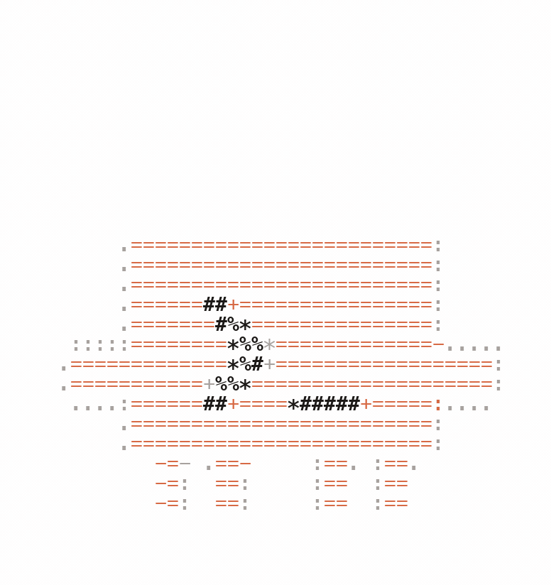

<p align="center">
  
</p>

<p align="center">
  Multi-agent terminal workspace built on <a href="https://github.com/ghostty-org/ghostty">Ghostty</a>.
  <br />
  Manage, monitor, and switch between Claude Code agents from a native macOS interface.
</p>

## About

Clawddy is a fork of [Ghostty](https://github.com/ghostty-org/ghostty) that adds a built-in agent workspace for managing multiple Claude Code terminal sessions. It inherits Ghostty's speed, native feel, and rendering quality while adding project/task/agent organization on top.

**What it does:**

- Organize agents into **projects** and **tasks** in a native three-column workspace
- Each agent runs Claude Code in its own terminal surface with session resume
- Effective model, reasoning effort, and context use are visible in every agent
  row and in a persistent, accessible detail inspector
- **Option+Space** opens a Spotlight-style search to jump between agents
- Selecting an agent previews it; explicit Start/Focus actions preserve keyboard intent
- Menu bar icon shows aggregate state (idle / running / needs attention)
- Lossless ordered lifecycle-event ingestion with bounded tail reads and compaction
- Targeted macOS notifications that reopen the exact agent
- System-standard workspace chrome with the terminal retaining its configured theme
- Agents drop to a shell when Claude exits so you never lose a terminal

## Architecture

Clawddy's agent features live in `macos/Sources/Features/AgentManagement/` with
integration points in `AppDelegate.swift` and the shared command palette. The
`upstream` branch tracks `ghostty-org/ghostty` main for clean merges.

```
macos/Sources/Features/AgentManagement/
  AgentConfig.swift                — Config persistence, migration, and Claude hooks
  AgentEnvironmentResolver.swift   — Nonblocking login-shell PATH discovery
  AgentEventJournal.swift          — Complete-record parsing and persisted offsets
  AgentMetadataRuntime.swift       — Claude status-line capture and forwarding
  AgentSessionMetadata.swift       — Official metadata decoding and formatting
  AgentMetadataViews.swift         — List, header, and inspector metadata UI
  AgentStateReducer.swift          — Deterministic runtime state transitions and effects
  AgentTerminalBridge.swift        — Agent lifecycle, event ingestion, and notifications
  AgentTerminalHost.swift          — Terminal model/delegate adapter for each agent
  AgentDetailViewController.swift  — Terminal-surface ownership and switching
  AgentWorkspaceViews.swift        — Navigation, agent list, search, and editing
  AgentCommandPaletteView.swift    — Agent entries for the shared command palette
  AgentSearchPanel.swift           — Floating command-palette panel
  AgentWorkspaceController.swift   — Split-view workspace and window creation
  BridgeMetrics.swift              — Agent-bridge diagnostics
```

Read [Clawddy Agent Architecture](docs/CLAWDDY_ARCHITECTURE.md) for component
ownership and state invariants. Read
[macOS Development](docs/MACOS_DEVELOPMENT.md) before changing Apple-framework
integration, permissions, accessibility, rendering, or build settings.

## Setup

### Prerequisites

- macOS 15.6 or newer for the Xcode 26 development toolchain
- Xcode 26 with the macOS 26 SDK and Metal Toolchain
- [Zig 0.15.2](https://ziglang.org/download/)

The built application itself has a macOS 14 deployment target.

### Build

```sh
macos/build.nu --scheme Ghostty --configuration Debug --action build
open macos/build/Debug/Ghostty.app
```

When shared Zig code outside `macos/` changes, run
`zig build -Demit-macos-app=false` before the macOS build. See
[Developing Ghostty](HACKING.md) for tests, linting, and toolchain setup.

### Agent config

Agents are defined in `~/.config/ghostty-agents/agents.json`:

```json
{
  "projects": [
    {
      "id": "B150F75F-55CD-44BE-8994-3B8A840D71B5",
      "name": "myproject",
      "workingDirectory": "/path/to/project",
      "tasks": [
        {
          "id": "2FCF5403-85C9-4B95-85A9-9978FB1C2F02",
          "name": "feature",
          "agents": [
            {
              "id": "534A7DB8-4623-4C40-A3C6-DF5914D1302B",
              "name": "agent-1"
            }
          ]
        }
      ]
    }
  ]
}
```

IDs are stable identities; names may change. Older name-only configuration is
migrated automatically. Claude Code hooks are installed automatically to track
session and lifecycle events.

## Syncing with upstream Ghostty

```sh
git fetch origin main
git checkout upstream
git merge origin/main
git checkout main
git merge upstream
```

## Credits

Built on [Ghostty](https://github.com/ghostty-org/ghostty) by Mitchell Hashimoto and contributors.
